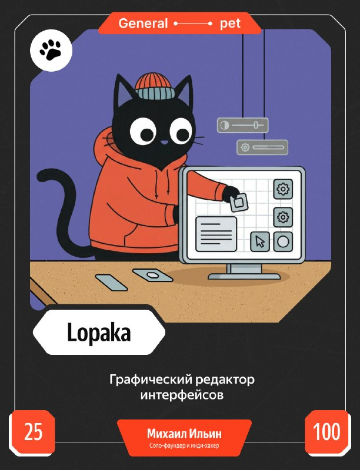

🐾 **Pet projects from our subscribers: a UI graphics editor**

🗂 Engineers and designers of electronic devices with small screens often have a hard time creating visual elements: you have to calculate their sizes, margins, and text positions by hand. And any change, even the tiniest one, forces you to start over from scratch.

Mikhail Ilin, a solo founder and indie hacker, couldn't find a single convenient tool that solved this problem. So he built his own universal graphics editor for low-resolution embedded displays: Lopaka. It runs right in the browser and outputs ready-made source code that you can copy and paste into your project ✨

⏯ **What you can do in Lopaka:**

✅ Draw basic shapes

✅ Add text in different fonts

✅ Insert images

✅ Generate ready-to-use code for u8g2, TFT_eSPI, Flipper Zero, and other popular libraries

✅ Convert images to XBMP

⏩️ [**Link to GitHub**](https://github.com/sbrin/lopaka)

⏩️ [**Link to the website**](https://lopaka.app/)

Subscribe:

💬 [@Yandex4Developers](https://t.me/Yandex4Developers)
