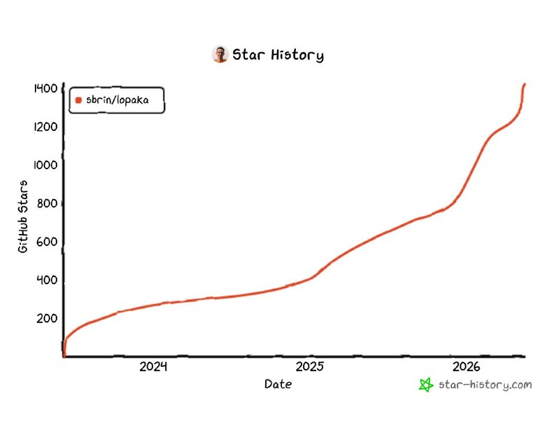

Is that a HOCKEY STICK?

In the startup world, the term "hockey stick" (or "hockey stick growth") describes a model of explosive, exponential growth. On a chart, it looks like a hockey stick: first a long stretch of flat or slow growth (the shaft), followed by a sharp vertical jump (the blade).
