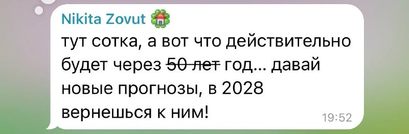

[I already called it on Twitter](https://x.com/ilin_pt/status/2039060975555330201):

The next big releases from OpenAI or Anthropic will be multi-agent systems wrapped in a single API call.

Just like it used to be a plain chat, then they wrapped reasoning around it, and then tools. Now they'll wrap the whole system of agents.

To users, it'll just be GPT-6, but under the hood it'll be a multimodal thinking system of agents with orchestration.

You can already see this partly coming true. The current trend is to ship the model + the interface + the harness all together.
