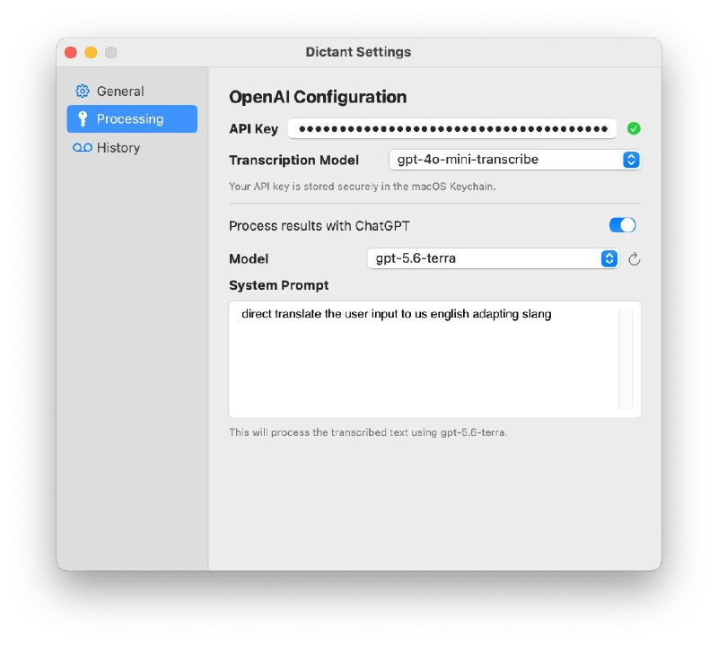

I updated Dictant!

You can now choose the transcription model and the processing model, like you asked.

Seems like a small thing, but I use it every day.

[https://github.com/sbrin/Dictant/releases/tag/1.32](https://github.com/sbrin/Dictant/releases/tag/1.32)
