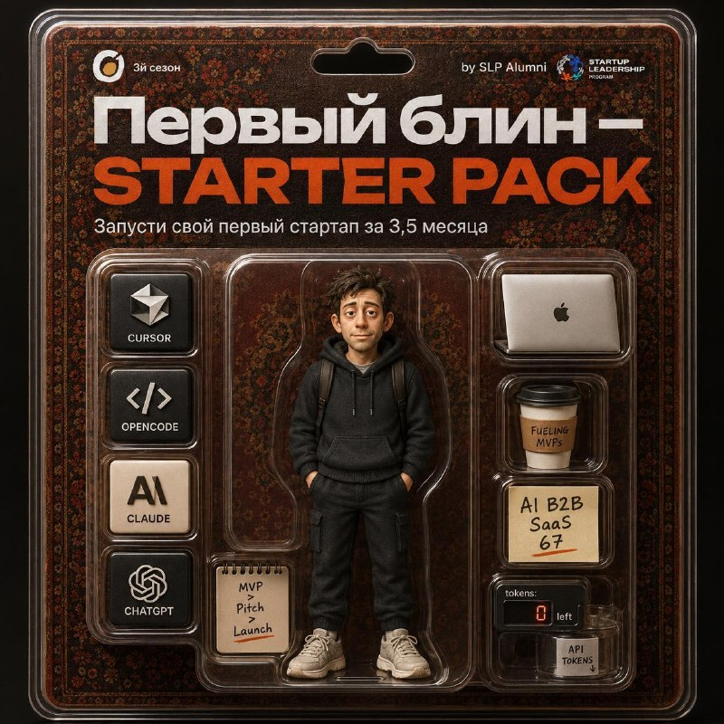

I'm working with the folks from SLP on an educational and development program called Pervyi Blin (literally, "First Pancake"). The idea is to share experience and knowledge with the younger generation and help make sure there are more entrepreneurs in the world.

This is already the third cohort of the program. Before, I took part as a mentor, helped put together classes, and was on the tracking side when students launched their projects. This season I'm on the organizing team, and I really love what we're doing.

It's kind of like an accelerator, a bootcamp, or a lab. The target audience is young people who've never had any entrepreneurial experience and are itching to launch their own project.

We took SLP's core principles, took the peer-to-peer learning model, and completely reworked the program this season. Now more than half of our time goes to practice and developing your project.

Students use AI skills: they build them themselves, refine them, and apply them to their own project. But the most important part of the program is getting to the sales stage. We want people to go from an idea to actually validating it as fast as possible, to go out and sell, do marketing, and make money on their product.

I think that's what sets us apart from any other program. Plus, a really powerful community gathers here.

So if you've wanted to start your own business for a while and you actively use AI agents, or you know people like that under 30, welcome.

I'll be right in the thick of it: mentoring, coaching, and helping out any way I can. Below is the attention-grabbing post.

↓↓↓

Pervyi Blin has opened enrollment for Season 3, a startup launch program that runs ONCE A YEAR

If you've got even the slightest thought about your own startup, IT'S YOUR CHANCE!

What's inside:

- 3.5 months of full immersion
- Founder mentors (real ones, not theorists)
- Pitch Day with 600K+ rubles in prizes for the top 3
- 60 spots total

I think this is the event of the year for young founders, because there are barely any opportunities like this in Russia, you can count them on one hand...

Deadline is the end of August, spots are limited

→ [https://y1blin.com](https://y1blin.com/)

If it's not you, forward it to whoever needs it. Seriously!
