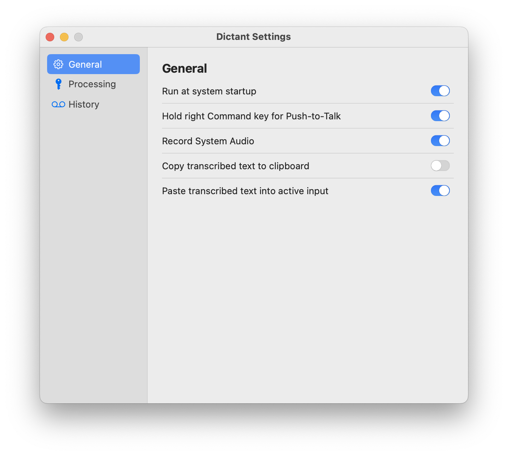
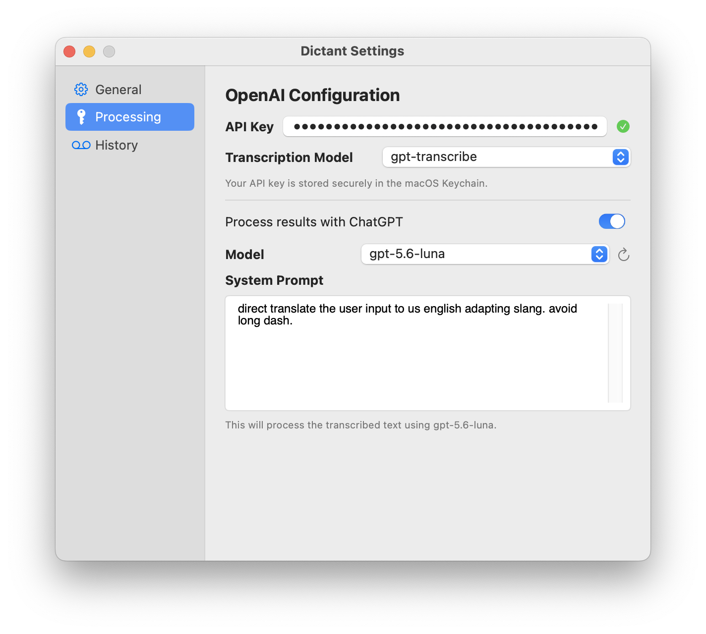

I wanted a dictation app for Mac that works instantly and does not get in the way, so I built one.

[Dictant](https://github.com/sbrin/Dictant) is a tiny menu bar push-to-talk app: hold the right Command key, speak, release, and get clean text in your clipboard (and optionally auto-pasted to the active app).

It uses OpenAI Whisper for transcription, can run an optional ChatGPT cleanup pass with your own prompt, keeps API keys in Keychain, and stores recordings locally.

No subscriptions, no paywall. It is free and open source, you only pay for your OpenAI API usage.

Dictant can now also transcribe audio playing on your Mac together with the microphone. You can choose between OpenAI's current transcription models and Whisper, then optionally process the result with ChatGPT using your own prompt—for cleanup, formatting, translation, or other text transformations.

## Highlights

- Fast push-to-talk from anywhere in macOS
- Optional system audio capture alongside the microphone
- Automatic clipboard copy and paste into the active input
- Selectable transcription and ChatGPT models
- Custom prompt for polishing, formatting, or translating the result
- Local history with recordings, transcripts, and retries
- Automatic silence trimming before transcription
- API key stored securely in macOS Keychain

## Screenshots

<figure>
  
  <figcaption>General settings, including optional system audio capture.</figcaption>
</figure>

<figure>
  
  <figcaption>Choose transcription and ChatGPT models, then shape the result with a custom prompt.</figcaption>
</figure>

Recordings and history stay on your Mac; only transcription and optional post-processing requests are sent to OpenAI.

- GitHub: [sbrin/Dictant](https://github.com/sbrin/Dictant)
- Latest release: [Dictant releases](https://github.com/sbrin/Dictant/releases)
